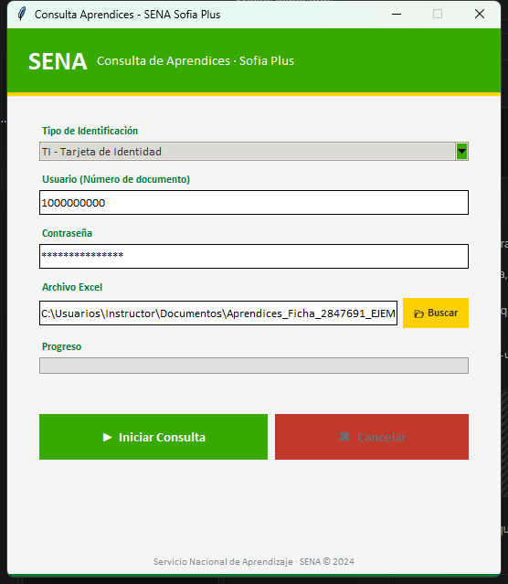
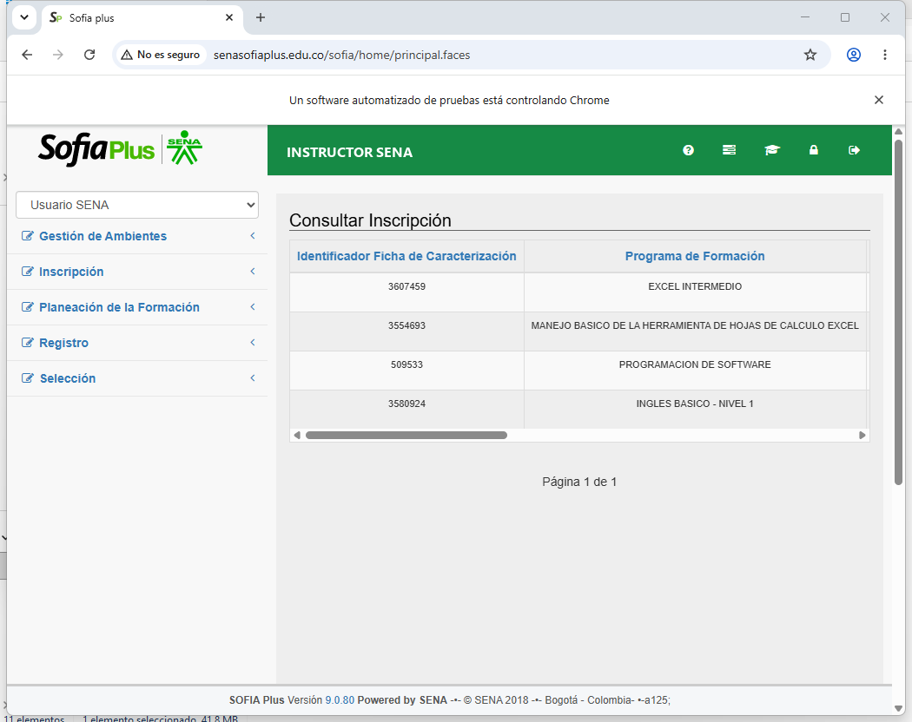
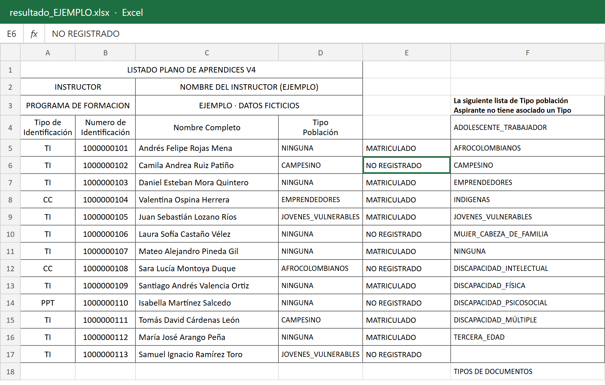

# RPA Bot: Excel → Government Portal With No API (Python + Selenium)

SENA instructors (Colombia's national training service) had to look up every learner's ID **by hand** in Sofia Plus, a government portal with no API, to confirm enrollment.

This Windows desktop app takes the Excel list, logs into the portal once and checks each ID row by row with Selenium. Results go into a **new copy** of the Excel (`resultado_<date>.xlsx`), so the original file is never touched.



## Features

- Automates a portal with **no API**: handles the login iframe, ID type and role selection
- Reads the Excel with pandas + openpyxl and finds the ID columns by name
- Result per learner: `MATRICULADO` (enrolled), `NO REGISTRADO` (not found) or `ERROR: …`
- One failed row never stops the run
- Live progress bar and cancel button; partial results are saved if cancelled
- ChromeDriver installed automatically (webdriver-manager)
- Packaged as a single Windows `.exe` with PyInstaller, plus a visual user manual for non-technical staff

| Selenium driving the portal | Results written to Excel (sample data) |
|---|---|
|  |  |

> Screenshots use **test data and fictional names/IDs**. No real learner data is included in this repository.

## Files

| File | What it does |
|---|---|
| `main.py` | Tkinter app: file picker, credentials, progress bar, Excel read/write, lookup loop |
| `login.py` | Selenium login: iframe, ID type, user/password, role selection |
| `config.py` | Portal URL |

Credentials are typed in the app at runtime; **nothing is stored** in code or on disk.

## Run it

```bash
pip install -r requirements.txt
python main.py
# optional: build the .exe
pip install pyinstaller
pyinstaller --onefile --windowed main.py
```

The UI and messages are in Spanish because the users are Colombian instructors.

## Stack

Python · Selenium · pandas · openpyxl · Tkinter · PyInstaller

---

Built by **Luis E. Giraldo** — n8n & AI automation engineer (Digitrion). Available on Upwork.
